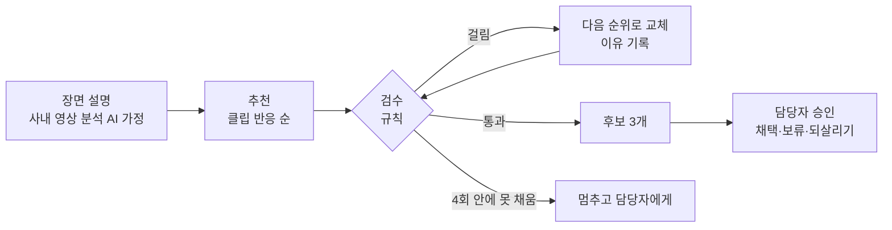

# Scene Checker

**AI 가상간접광고(VPPL)에 넣을 장면을 추천하고, 답이 있는 조건은 먼저 거르는 광고 현업용 사내 도구 프로토타입**

▶ 라이브 페이지: https://nanaaanan.github.io/scene-checker/

> TVING, CJ ENM과 무관한 개인 포트폴리오입니다. 작품명과 작품 이미지만 실제이고, 회차, 장면, 출연자, 브랜드, 계약 정보는 모두 가상입니다.

---

## 한눈에

| | |
|---|---|
| 문제 | 제품은 AI가 넣지만, 어느 장면에 넣을지는 사람이 회차와 계약서를 다시 보며 고릅니다. |
| 도구 | 브리프에 맞는 장면을 클립 반응 순으로 추천하고, 출연자 권리·경쟁 브랜드·금지 맥락·합성 조건에 걸리면 다음 후보로 바꿉니다. 완성도 판단은 담당자에게 남깁니다. |
| 검증 | 정답을 먼저 적은 평가셋 12건에서 조건 위반 14개 중 12개를 잡았습니다. 놓친 2개와 잘못 잡은 1개도 공개합니다. |
| 도입 | 방영 중인 예능 한 편으로 5주 파일럿, 넓히고·고치고·멈추는 기준을 미리 정했습니다. |

---

## 1. 왜 이 문제인가

- CJ ENM은 2025년 3월 방송에 AI로 제품을 합성하는 가상간접광고(VPPL)를 국내 처음 도입했습니다. ([ZDNet 2025.3](https://zdnet.co.kr/view/?no=20250313155349))
- 진행은 장면 선정 → AI 합성 → 제작진·광고주 검수 순이고, 적용 장면 검토와 출연자·브랜드 권리 검토, 플랫폼별 유통 기준까지 사람이 확인합니다. ([CJ 뉴스룸 2026.7](https://cjnews.cj.net/ai%EB%8A%94-%EA%B4%91%EA%B3%A0%EB%A5%BC-%EC%96%B4%EB%96%BB%EA%B2%8C-%EB%B0%94%EA%BE%B8%EA%B3%A0-%EC%9E%88%EB%82%98vppl%EB%A1%9C-%EC%82%B4%ED%8E%B4%EB%B3%B8-%EA%B0%84%EC%A0%91%EA%B4%91/))
- 담당자 인터뷰: "AI는 제품을 빠르고 정교하게 구현하고, 사람은 어느 장면에 적용해야 콘텐츠의 완성도를 해치지 않는지 판단". 방영 뒤 반응을 보고 장면을 고를 수 있고 기존 PPL보다 약 50% 저렴합니다. ([아주경제 2026.9](https://www.ajunews.com/view/20260829215551368))

**가설** (공개 자료로 확인하지 못해 현업 인터뷰로 가장 먼저 확인할 것): 방영 뒤에도 팔 수 있고 값이 낮으면 판매 건수가 늘고, 병목은 합성이 아니라 장면 선정과 권리 확인이 됩니다.

## 2. 어떻게 골랐나

**업무 분해** (CJ 뉴스룸 설명을 네 단계로 정리)

| 단계 | 누가 | 성격 | 도구의 몫 |
|---|---|---|---|
| 1. 장면 선정 | 사람 | 찾기는 탐색, 고르기는 판단 | 찾기만 맡음 |
| 2. 권리·유통 확인 | 사람 | 계약과 기준에 답이 있음 | 규칙으로 거름 |
| 3. AI 합성 | AI | 이미 자동화 | 하지 않음 |
| 4. 제작진·광고주 검수 | 사람 | 판단 | 하지 않음 |

**도구 후보 비교** (가치를 먼저 보고, 같으면 공수와 검증 가능성으로)

| 후보 | 가치 | 공수 | 검증 | 결론 |
|---|---|---|---|---|
| 장면 후보 추천·검수 | 높음 | 중간 | 바로 가능 | **선택** |
| 출연 계약 조건 정리 | 높음 | 중간 | 법무 확인 필요 | 다음 단계 |
| 방영 뒤 반응 리포트 | 중간 | 중간 | 바로 가능 | |
| 광고주 제안서 초안 | 중간 | 낮음 | 채점 어려움 | |
| 합성 결과 품질 검수 | 높음 | 매우 높음 | 채점 어려움 | |

## 3. 어떻게 동작하나

**자동으로 거르는 조건** (계약과 기준에 답이 있는 것만)

| 유형 | 예 |
|---|---|
| 출연자 권리 | 카테고리별 광고 제한 출연자 |
| 경쟁 브랜드 | 같은 장면에 경쟁 제품 노출 |
| 금지 맥락 | 주류 × 운전, 주류 × 미성년 출연자, 부상 장면 |
| 합성 조건 | 고정 샷 3초 미만 |

**거르지 않고 담당자에게 넘기는 것**: 권리 정보가 빈 출연자, 카메라가 빠르게 움직이는 장면, 눈물이나 결과가 드러나는 장면, 해외 동시 공개 회차.

**LLM의 자리**: 본인 API 키를 넣으면 광고주 제안 문장을 LLM이 씁니다(선택). 쓴 문장도 경쟁 브랜드명과 광고 제한 출연자 이름이 있는지 같은 규칙으로 다시 검사합니다. 판정은 LLM이 아니라 규칙이 합니다. 결과가 매번 같아야 하고, 맞았는지 채점할 수 있어야 하기 때문입니다.

## 4. 어떻게 검증했나

제외돼야 할 조건을 일부러 넣은 장면 12건과 정답표를 먼저 만들고, 페이지를 열 때마다 검수 엔진을 다시 돌려 채점합니다.

| 잡은 위반 | 놓친 위반 | 잘못 잡은 경고 |
|---|---|---|
| 12 / 14 | 2 | 1 |

- 놓침: 브랜드명 없이 '초록 뚜껑 두유팩'처럼 묘사된 경쟁 제품
- 놓침: 출연자 명단에 없는 학생 역 보조 출연자
- 잘못 잡음: 대화 속 '운전면허' 이야기를 운전 장면으로 판단

세 실수 모두 규칙이 장면 설명의 단어만 보기 때문입니다. 다음 단계는 **장면 속 사물과 인물은 LLM이 뽑고, 거를지는 규칙이 정하는 구조**입니다. 12건은 직접 만든 작은 평가셋이라, 점수보다 규칙을 고칠 때 좋아졌는지 나빠졌는지 보는 회귀 테스트로 씁니다.

## 5. 어떻게 도입하나

| 기간 | 할 일 |
|---|---|
| 1주 듣기 | VPPL 담당자와 광고 영업 3~5명에게 장면 고르는 기준과 최근 반려 사례를 듣고 규칙을 고칩니다. |
| 2주 잇기 | 사내 장면 분석 결과와 출연 계약 정보를 연결하고, 평가셋을 과거 제안 이력으로 바꿉니다. |
| 2주 비교 | 담당자 절반만 도구를 쓰고, 후보 고르는 시간과 채택 비율을 비교합니다. |

| 결과 | 결정 |
|---|---|
| 시간이 줄고, 추천 3개 중 채택이 절반 이상 | 넓힙니다 (다른 예능, 드라마) |
| 시간은 줄었는데 채택이 낮음 | 순위 기준부터 고칩니다 |
| 담당자 절반 이상이 2주 동안 쓰지 않음 | 멈추고 인터뷰부터 다시 합니다 |

볼 숫자: 주간 활성 사용자, 추천을 채택한 비율, 자동 제외를 되살린 비율. 기준 수치는 제가 정한 초기값이라 첫 주 기준선을 잰 뒤 확정합니다. 아직 하지 않은 계획입니다.

## 6. 제작 노트: 판단 기록

| 판단 | 고른 것 | 고르지 않은 것과 이유 |
|---|---|---|
| 주제 | CJ ENM이 지금 운영하는 VPPL의 장면 선정 | 홍보 문구 검수(이전 판): 지금의 AI 이슈라는 공개 근거가 약했습니다 |
| 판정 방식 | 규칙 | LLM 판정: 같은 입력에 결과가 달라질 수 있고 채점이 어렵습니다 |
| 정보가 빈 출연자 | 확인 필요로 넘김 | 통과: 가장 비싼 실수가 됩니다 |
| 자동 제외 | 이유를 보여 주고 되살릴 수 있게 | 조용히 제외: 도구가 틀렸을 때 담당자가 알 수 없습니다 |
| 데이터 범위 | 장면과 계약 정보만 | 회원 정보: 필요 없고, 보안 검토 범위만 넓힙니다 |

방향과 판단 기준은 제가 정하고, 조사 정리와 구현은 AI코딩 도구와 함께했습니다.

## 7. 코드 안내

파일 하나(`index.html`)로 동작합니다. 빌드나 서버가 필요 없고, 이미지는 파일 안에 넣었습니다.

| 보면 좋은 곳 | 내용 |
|---|---|
| `CONFIG` | 제출 전 채우는 값 (이름, 링크) |
| `SHOWS`, `CONTRACTS`, `BRIEFS` | 가상 장면, 출연 계약, 광고주 브리프. 사내 기준으로 바꿔 끼울 수 있게 분리 |
| `EVAL` | 평가셋 12건과 사람이 먼저 적은 정답 |
| `checkScene()` | 검수 엔진. 자동 제외 4종과 담당자에게 넘기는 4종 |
| `runAgent()` | 추천 → 검수 → 교체, 최대 4회 |
| `checkPitch()` | LLM이 쓴 제안 문장을 같은 규칙으로 다시 검사 |

- 주소 뒤에 `?intro=0`을 붙이면 인트로를 건너뜁니다.
- API 키는 페이지 메모리에만 있고 저장하지 않으며, 고른 API로만 보냅니다.

## 출처와 저작권

- 작품 이미지는 TVING 작품 페이지의 공식 대표 이미지이며, 저작권은 CJ ENM 등 각 권리자에게 있습니다.
- 돋보기를 든 손 사진은 Pixabay 무료 이미지(hands-4601168, Pixabay Content License)를 좌우 반전해 썼습니다.
- TVING 2분기 광고 매출 전년 대비 52% 증가: [디지털데일리 2026.8](https://m.ddaily.co.kr/page/view/2026080615090115732)
